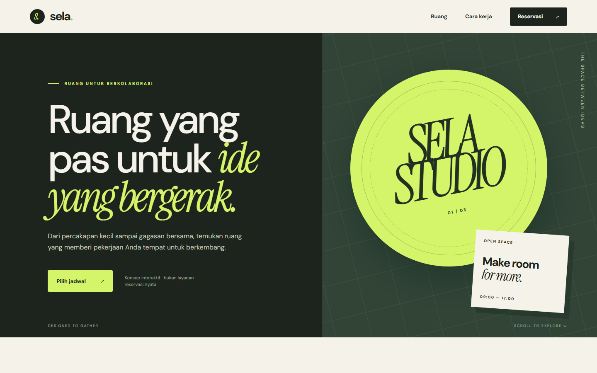

# Sela — booking interface concept

Sela is an Indonesian-language frontend portfolio project: a responsive, accessible room-booking flow from room selection to a local confirmation. It is an **interactive concept, not a real venue or booking service**.

[Open the live demo](https://sela-booking-ui.vercel.app/) · [View CI checks](https://github.com/indraaryaLabs/sela-booking-ui/actions)



The [booking view](screenshots/desktop-booking.png) and [mobile view](screenshots/mobile-hero.png) show the same interface at different sizes.

## What it demonstrates

- React and TypeScript component/state design for a multi-step booking journey
- Asynchronous JSON availability loading with loading, error/retry, and empty states
- Date, room, capacity, email, and slot validation with associated form labels and focus feedback
- Browser-local persistence and conflict prevention for the same slot
- Responsive visual system built with CSS illustrations and locally bundled fonts
- Playwright checks for the happy path, validation, network failure, persistence, and mobile width

The availability endpoint is a static fixture (`public/availability.json`). Bookings are stored only in that browser's `localStorage`: they do not synchronize across users, reserve a physical room, send email, or take payment. All spaces, rates, and availability are fictional demo data.

## Run

Requires Node.js 24+ and npm.

```bash
npm ci
npm run dev
```

For verification:

```bash
npm run build
npx playwright install chromium
npm test
```

The [design note](docs/plans/2026-09-24-sela-design.md) records scope and trade-offs. This project is independent of the [Reliability Quality Suite](https://github.com/indraaryaLabs/reliability-quality-suite).

For reproducible visual screenshots, `scripts/visual_audit.py` can be run with Python Playwright while the Vite server is running on port 4173.
